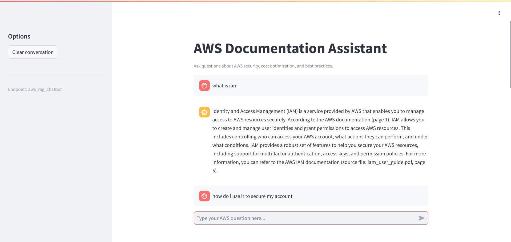
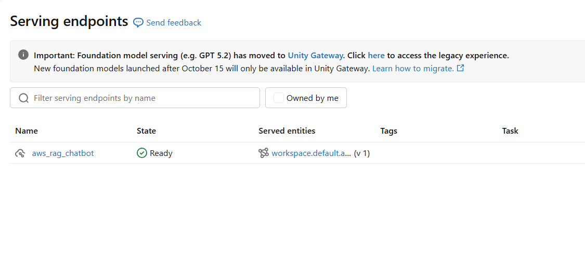
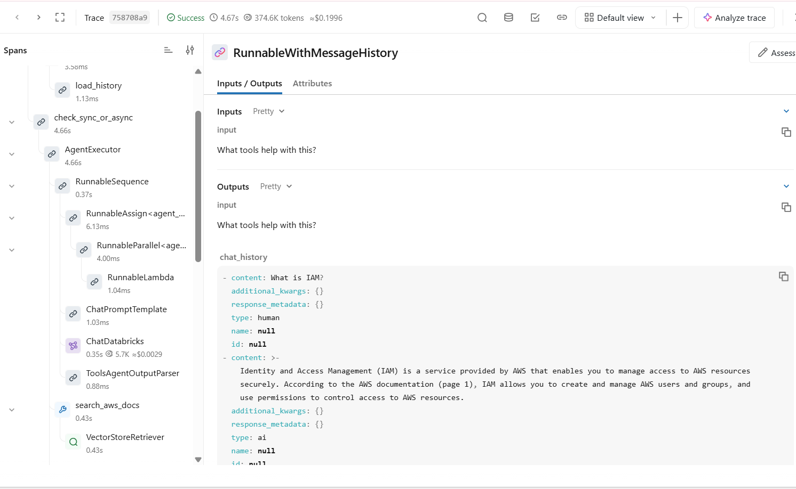

# AWS Agentic RAG Assistant

A tool-calling AI agent that answers questions about AWS using official AWS documentation.
Built on Databricks Free Edition with LangChain, Databricks Vector Search, Meta Llama 3.3 70B and MLflow.

## Screenshots

| Chat app | Serving endpoint | MLflow trace |
|---|---|---|
|  |  |  |

## What it does

- Answers AWS questions using only retrieved documentation, with source file and page citations.
- Picks the right tool for each question: document search, acronym expansion, source lookup or topic listing.
- Remembers earlier turns, so follow-up questions like "How do I use it?" work.
- Traces every run in MLflow: tool calls, tokens and latency.

## Architecture

```
AWS PDFs (Unity Catalog volume)
   -> 01 PyPDFLoader + RecursiveCharacterTextSplitter (1,000 chars, 200 overlap)
   -> Delta table workspace.default.pdf_chunks (Change Data Feed on)
   -> 02 Delta Sync vector index (Qwen3 embeddings), hybrid search
   -> 03 Tool-calling agent (4 tools, memory, max 5 iterations) + MLflow tracing
   -> 04 Registered in Unity Catalog, served on Databricks Model Serving
   -> chatbot_app  Streamlit chat UI (Databricks Apps)
```

## Results

| Metric | Value |
|---|---|
| Pages indexed | 557 |
| Chunks | 1,636 |
| Median query latency (endpoint, 10 queries) | 2.99 s |

## Tech stack

Python, PySpark, Delta Lake, Unity Catalog, Databricks Vector Search, LangChain, Meta Llama 3.3 70B,
Qwen3 embeddings, MLflow, Databricks Model Serving, Streamlit (Databricks Apps).

## Agent tools

| Tool | Purpose |
|---|---|
| `search_aws_docs` | Hybrid search over the indexed AWS documentation |
| `expand_aws_acronym` | Expands AWS acronyms such as IAM, EC2, KMS |
| `get_document_source` | Describes a source PDF |
| `list_available_topics` | Lists the topics the assistant covers |

## How to run

1. Upload `aws-overview.pdf`, `wellarchitected-security-pillar.pdf` and
   `wellarchitected-cost-optimization-pillar.pdf` to `/Volumes/workspace/default/documents`.
2. Run `01_chunk_pdfs.py`, then `02_create_vector_index.py`.
3. Run `03_rag_agent.py` to test the agent and see MLflow traces.
4. Run `04_deploy_agent.py` to register and serve the agent.
5. Deploy `chatbot_app/` as a Databricks App and give it **Can Query** on the `aws_rag_chatbot` endpoint.

## Limitations

- Databricks Free Edition limits serving and search endpoints and compute quota.
- Conversation memory lives in the client and is not stored server-side.
- Knowledge covers only the three indexed AWS documents.
